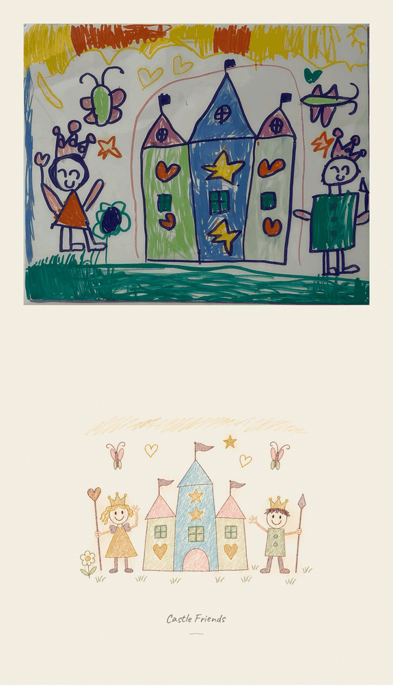

# 儿童画电子素描 GIF

`zenskill-kids-drawing-gif` 把一张孩子的手绘作品做成动画海报：上面完整保留原画（静止），下面是米色纸上缩小居中的精细彩铅小景，配手写感英文标题和连续缓动动画。



v5 是三姿势切换，停留 180–400 ms，观感「生硬」；v7 改为 72 帧连续缓动循环，动作更大、节奏错开，反馈是「这次效果好不少」。动画由精修一次的画稿切出精灵，再连续旋转、缩放和合成。

## 安装

```bash
npx -y skills add renzheng0415/zenskill-kids-drawing-gif -g --all
```

也可以把仓库放到 Agent 的 skills 目录，直接阅读 `SKILL.md`。

## 适用场景

- 输入一张儿童画，制作「上方原画静止、下方彩铅小景动起来」的海报 GIF
- 保留孩子的角色、翅膀、建筑、道具和配色，配米色留白与手写英文标题
- 需要连续自然的挥手、旗帜摆动、星星闪烁、花朵摇摆和蝴蝶振翅

## 制作要点

1. 先列母题清单，核对人物、头发、翅膀、门窗、花草昆虫、道具与颜色；不擅自添加或删改。
2. 用 Codex CLI 内置 image_generation 生成一次精细彩铅小景，不生成三姿势切换表；CLI 没有可选择的「Image 2.6」。
3. 海报默认 800×1392。原画完整不裁切；下方小景约宽 480px，视觉占下半区约 35%–45%，四周留白；只提取颜料，不留下纸框或接缝。标题使用 Caveat 和轻下划线。
4. 切出活动部件并补好底图，肩部用前景遮住接头。每个人都有可读的挥手（总弧度约 40–46°）；旗帜 ±11–13°，花朵 ±10°，星星缩放与透明度连续变化，蝴蝶错峰振翅。纸、标题、地面、建筑与手持物锁定。
5. 用 `scripts/build_living_sketch.py` 和逐画配置构建：72 帧、40ms/帧、整数周期缓动、2 倍超采样、全局调色板、无抖色。示例配置中的城堡坐标只适用于那张画。
6. 解码 GIF 验证静态区域像素一致、72 帧唯一、最长相同帧段为 1，检查相邻差异曲线和循环边界；亲自查看八帧联系表与每个活动部件的极值特写。
7. 默认交付小于 8MB 的全尺寸 GIF、起始/中段 PNG、静音 H.264 预览、联系表、报告和构建元数据。报告如实说明剪纸感、填底残影、眨眼重影或画稿偏差。

不使用原图扭曲、光流、骨骼重定向、拉伸四肢或三姿势停顿循环。完整步骤、参数与失败记录见 [SKILL.md](SKILL.md)。

## 微信副本（仅按需）

默认不导出微信压缩副本。用户明确要求时，使用 `--wechat` 另存最长边不超过 1000 像素的 GIF，不覆盖全尺寸版本。聊天图片可能受像素限制影响，不只是文件体积；不同客户端的播放表现需实际确认。

## 许可

MIT License. Copyright (c) 2026 renzheng0415.
